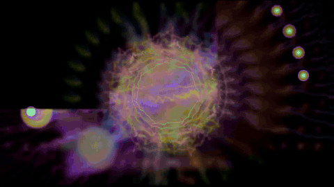

# oxiviz



An offline music visualizer that renders audio files to video. Its look is inspired by **Alchemy**, the classic
Windows Media Player visualization: a feedback warp that smears and swirls the previous frame, with beat-reactive
overlays drawn on top.

oxiviz runs headless and renders on the CPU, so it fits in a server or container. It decodes audio with ffmpeg,
renders frames, and pipes them back to ffmpeg to encode the video. Rendering is deterministic: the same audio and seed
always produce the same video.

## Usage

```sh
oxiviz song.mp3 -o song.mp4
oxiviz song.flac -o out.mp4 --size 1920x1080 --fps 60 --seed 42
```

The input can be any audio or video file ffmpeg reads. Its audio becomes the video's soundtrack. The output is H.264
video with AAC audio.

| Option | Default | |
|---|---|---|
| `-o, --output <FILE>` | | Video file to write, or `-` for raw frames on stdout (see below) |
| `--size <WxH>` | `1280x720` | Size of the video. Width and height must be even |
| `--render-height <PX>` | `360` | Height the effects render at before they're scaled up to `--size` |
| `--fps <N>` | `30` | Frames per second |
| `--seed <N>` | random | Seed for the random choices. oxiviz prints the seed it used, so you can render the same video again |
| `--duration <SECS>` | whole file | Only render the first this many seconds |
| `--levels` | | Print bass and beat statistics instead of rendering (see below) |

**Effect size.** Effects are sized in pixels for small frames. oxiviz renders them at
`--render-height` (keeping the aspect ratio of `--size`), then ffmpeg scales the video up to `--size`. So the effects
look the same at any output size. Raise `--render-height` for smaller, sharper effects; lower it for bigger, blockier
ones.

**Frame rate.** Effects move a fixed amount per frame, so a higher `--fps` also makes them move faster.

**Raw frames.** With `-o -`, oxiviz writes frames to stdout instead of encoding a video, for a caller that runs its
own encode. Frames are `bgr0` (4 bytes per pixel) at the render size, which oxiviz prints on stderr, and have no audio:

```sh
oxiviz song.mp3 -o - --size 1280x720 | ffmpeg -f rawvideo -pix_fmt bgr0 -s 640x360 -r 30 -i pipe:0 -i song.mp3 \
  -map 0:v -map 1:a -vf scale=1280:720 -c:v libx264 -pix_fmt yuv420p -c:a aac -shortest out.mp4
```

**Audio calibration.** Beat detection expects the bass level to sit around 0.3–0.8 on typical music.
`oxiviz song.mp3 --levels` prints a song's bass percentiles and beats per minute to check that. The scale is set by
`SPECTRUM_FLOOR_DB` in `crates/audio/src/analyzer.rs`.

Progress goes to stderr: a live percentage on a terminal, or a line every 10% when stderr is a log.

### Requirements

- Rust 1.85+ (edition 2024) and a C linker to build (`build-essential` on Debian/Ubuntu)
- `ffmpeg` on `PATH`

## Building

```sh
cargo build --release
```

Dev builds use `opt-level = 1`, because unoptimized rendering is too slow to test anything with.

## How it works

Each video frame goes through three stages:

1. **Audio analysis**: the audio is decoded and split into one chunk per video frame. Each chunk becomes a spectrum and
   waveform, plus bass and treble levels and beat / big-beat detection against a rolling average.
2. **Scheduling**: a scheduler keeps a feedback warp and a few overlays active. It runs each one for a random number of
   frames, then swaps it for a freshly randomized one.
3. **Rendering**: the warp reads the previous frame and writes the current one, and the overlays draw on top.

### Effects

| Effect | Kind | Description |
|---|---|---|
| Undertow | full-screen warp | the feedback core of the look; warps include scroll, swirl, weave and kaleido |
| Polygram | overlay | a polygon of waveform lines that scales with the bass and spins with the treble |
| Twin Orbs | overlay | two mirrored, bouncing glowing balls that pulse on beats and are linked by a waveform line |
| Ribbon | overlay | a spinning waveform line across the screen, optionally with a crossing second line |
| Surge | view | zooms in on bass hits and bounces back |

## Project layout

```
crates/
  engine/   turns per-frame audio data into pixels; no I/O
  audio/    decodes audio with ffmpeg and produces per-frame spectrum/waveform data
  cli/      the oxiviz binary: wires audio → engine → ffmpeg encoder
```

## License

MIT
